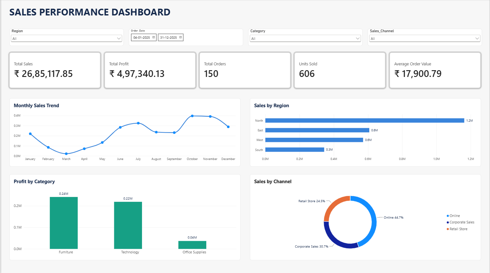

# 📊 Sales Performance Dashboard

### End-to-End Data Analytics Project | Excel • MySQL • Power BI

An end-to-end data analytics project focused on analyzing sales performance, profitability, regional trends, product categories, and sales channels using Microsoft Excel, MySQL, and Power BI.

---

## 📸 Dashboard Preview



---

## 📌 Project Overview

The **Sales Performance Dashboard** project analyzes a sales dataset containing 150 orders recorded during 2025.

The project follows an end-to-end data analytics workflow, starting with dataset exploration and validation, followed by SQL-based business analysis and interactive dashboard development in Power BI.

The main objective is to transform raw sales data into meaningful business insights that can support data-driven decision-making.

## 🎯 Project Objectives

- Analyze overall sales and profit performance.
- Identify monthly sales trends and patterns.
- Compare sales performance across different regions.
- Evaluate product category profitability.
- Analyze sales contribution by different sales channels.
- Understand customer segment performance.
- Build an interactive dashboard for business reporting.
- Perform data quality and reconciliation checks using SQL.

## 🛠️ Tools & Technologies

| Tool | Purpose |
|---|---|
| Microsoft Excel | Dataset exploration, calculations, and data validation |
| MySQL 8.4 | Database creation, data storage, and SQL analysis |
| Power BI Desktop | Interactive dashboard and data visualization |
| GitHub | Project documentation and version control |

## 📂 Repository Structure

```text
Sales-Performance-Dashboard/
│
├── README.md
│
├── Sales_Performance_Dashboard_Dataset.xlsx
│
├── Sales_Performance_Dashboard_Dataset.csv
│
├── Sales_Analysis_Queries.sql
│
├── Sales_Performance_Dashboard.pbix
│
└── Sales_Performance_Dashboard_Preview.png
```

## 📁 Dataset Description

The project uses order-level sales data covering January to December 2025.

| Dataset Attribute | Details |
|---|---|
| Total Records | 150 orders |
| Reporting Period | January – December 2025 |
| Currency | Indian Rupee (INR) |
| Data Formats | XLSX and CSV |
| Data Granularity | Individual order |
| Primary Identifier | Order_ID |

### Key Dataset Columns

- **Order Details:** Order_ID, Order_Date
- **Customer Information:** Customer_ID, Customer_Segment
- **Geographical Information:** Region, State, City
- **Sales Information:** Sales_Channel, Category, Sub_Category, Product
- **Quantity and Pricing:** Quantity, Unit_Price_INR, Discount_Pct
- **Financial Metrics:** Sales_INR, Cost_INR, Profit_INR
- **Validation Fields:** Profit_Check, Sales_Check, Sales_Difference

## 📈 Key Performance Indicators (KPIs)

The dashboard presents the following overall business metrics:

| KPI | Result |
|---|---:|
| Total Sales | ₹26,85,117.85 |
| Total Profit | ₹4,97,340.13 |
| Total Orders | 150 |
| Total Units Sold | 606 |
| Average Order Value | ₹17,900.79 |
| Profit Margin | 18.52%
